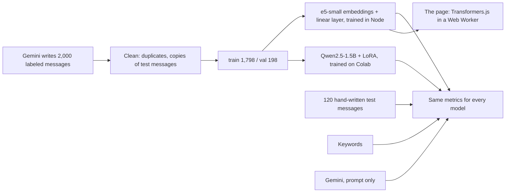

# Intent classifier: fine-tuning vs prompting

Which of five things a customer message is about (exchange, late order, question, serious complaint, other), answered four ways and measured on the same 120 hand-written messages: keyword rules, a small model that runs in the visitor's browser, a 1.5B LLM fine-tuned with LoRA, and Gemini with only a prompt.

Project 10 of a 12-project AI engineering track focused on front-end. It uses the labels from [project 9](https://github.com/Flaviohorbach/support-triage-workflow), where a model sorts real support messages. The interface is in Portuguese.

**[Live demo](https://flaviohorbach.github.io/intent-classifier-finetune/)**: the browser model runs on your device, and nothing you type leaves it.

## Results

| | Accuracy | Serious complaints caught | Time per message | Runs on |
| --- | --- | --- | --- | --- |
| Keywords (project 9) | 52.5% | 7 of 24 | under 1 ms | anywhere |
| **e5-small + trained layer** | **82.5%** | 17 of 24 | 81 ms | the visitor's browser, 118 MB once |
| Qwen2.5-1.5B, prompt only | 42.5% | 3 of 24 | 321 ms | GPU (T4) |
| **Qwen2.5-1.5B + LoRA** | **95.0%** | **23 of 24** | 261 ms | GPU (T4), trained in 6.8 min |
| Gemini 3.6 Flash, prompt only | **98.3%** | **24 of 24** | API call | Google's servers |

Test: 120 messages written by hand before any training data existed ([commit history](https://github.com/Flaviohorbach/intent-classifier-finetune/commits/main) shows the order), 30 of them from project 9. Per-label scores, confusion matrices and every error are on the demo page and in [`results/summary.json`](results/summary.json).

## What the numbers say

- **Fine-tuning turned a useless small model into a near match for a large one.** Before LoRA, Qwen2.5-1.5B got 42.5% and answered something that was not a label 43 times. Seven minutes of training on a free GPU, adjusting 1.2% of its weights, took it to 95.0% and 23 of 24 serious complaints, 3 points behind Gemini. That is the case for fine-tuning: a model you can run yourself, with no per-call price and no data leaving your servers.
- **Gemini with a good prompt was still the best.** It missed 2 of 120, both messages whose label I had hesitated over. When calls to an API are acceptable, a large model with a clear guide needs no training at all.
- **The browser model is the cheap, private option.** 82.5% with no server, no API key and no data leaving the device, in 81 ms per message after a one-time download. It is good enough to sort a queue, not to decide alone, which is why the page warns when its top two answers are nearly tied.
- **The keyword rules did not generalize.** They got 20 of project 9's 30 cases right but 52.5% here. They were written with those 30 cases in mind; a small test set flatters whatever was built while looking at it.
- **Validation was optimistic.** The browser model scored 88.9% on synthetic validation data and 82.5% on real messages. That gap is the price of training on generated text.

## The data, and what it taught

Training data is 2,000 messages written by Gemini: each call combined one label, one writing style (WhatsApp shorthand, formal, typos, angry capitals, irony, elderly and polite, two subjects in one message…) and one product category. After removing 4 messages too close to test messages, 1,798 went to training and 198 to validation.

**The generator had a blind spot, and both trained models learned it.** Of 360 serious complaints, 72 are about wrong charges and only 17 about harm to health or safety, and 3 harm messages came labeled as exchanges ("o frasco cortou minha mão" → `troca`). The browser model then missed exactly those cases in the test: an allergic reaction and a child cut by a toy were classified as exchanges. The LoRA model, far stronger overall, missed one serious complaint, and it was the same allergic reaction. More data would not fix this; asking the generator for that case would. The data was not corrected by hand after looking at it, so the numbers stay honest.

## How it works



- **Browser model.** [multilingual-e5-small](https://huggingface.co/Xenova/multilingual-e5-small), frozen and quantized to 8 bits, turns a message into 384 numbers; a linear layer trained here turns those into five probabilities. This is a *linear probe*, not a full fine-tune: only the last layer learns. It trains in seconds with no library ([`src/lib/head.ts`](src/lib/head.ts)), and the same file runs in training and on the page.
- **LoRA.** [`notebooks/finetune_qwen_lora.ipynb`](notebooks/finetune_qwen_lora.ipynb) measures Qwen2.5-1.5B before training, fine-tunes 18.5 million weights (1.2%) for 2 epochs on a free T4, measures again and saves the predictions. It runs on Colab or Kaggle; this run was on Kaggle, because Colab had no free GPU that day. The loss counts only the label, not the prompt.
- **Gemini.** The labeling guide in the prompt, 10 messages per call to fit the free quota. Batching can change answers, so this is "Gemini as used here", not Gemini at its best.

## Decisions

- **The test set came first.** It was written and committed before generating any training data, and the generator never saw it. A leak check drops generated messages too similar to a test message.
- **Thresholds and settings were chosen on validation only.** The test set was scored once per model.
- **Same input, same answer, in training and on the page.** Training embedded texts in batches at first, and the page one at a time. The 8-bit model scales its numbers per batch, so the same message came out slightly different, enough to flip close calls. Training now embeds one at a time; across all 120 test messages, the page and the evaluation agree on 118. The other 2 are near ties (24% vs 24%, 29% vs 28%) where WebAssembly and native code round differently; on the page the model scores 98 of 120.
- **A 118 MB download only on request.** Most of it is the vocabulary for 100 languages. The page downloads it when the visitor asks, shows progress, and the browser caches it.

## Limits

- **120 test messages** written by the same person who wrote the guide. Enough to see large gaps, not to rank models that are a few points apart.
- **Synthetic training data** with known label noise.
- **One run per model.** No error bars.
- **Latency is from one laptop** for the browser model, from a T4 for Qwen (one message at a time), and per call for Gemini, which includes the network.

## Run it

Requires Node 22 or later.

```bash
npm install
npm run dev          # the page; uses the trained layer already in public/model
npm test             # metrics, leak check, the linear layer
npm run eval         # rescores every saved prediction, no API calls
```

To rebuild everything: `npm run data:generate` (Gemini key in `.env.local`, about 50 calls), `npm run data:check`, `npm run train:probe`, `npm run eval -- --gemini`, and the Colab notebook for LoRA.

## Built with AI

Written with a coding agent. [`docs/AI-LOG.md`](docs/AI-LOG.md) records what it got wrong, and [`docs/CONCEITOS.md`](docs/CONCEITOS.md) is a study guide in Portuguese.

## License

MIT. Qwen2.5 is Apache 2.0; multilingual-e5-small is MIT.
